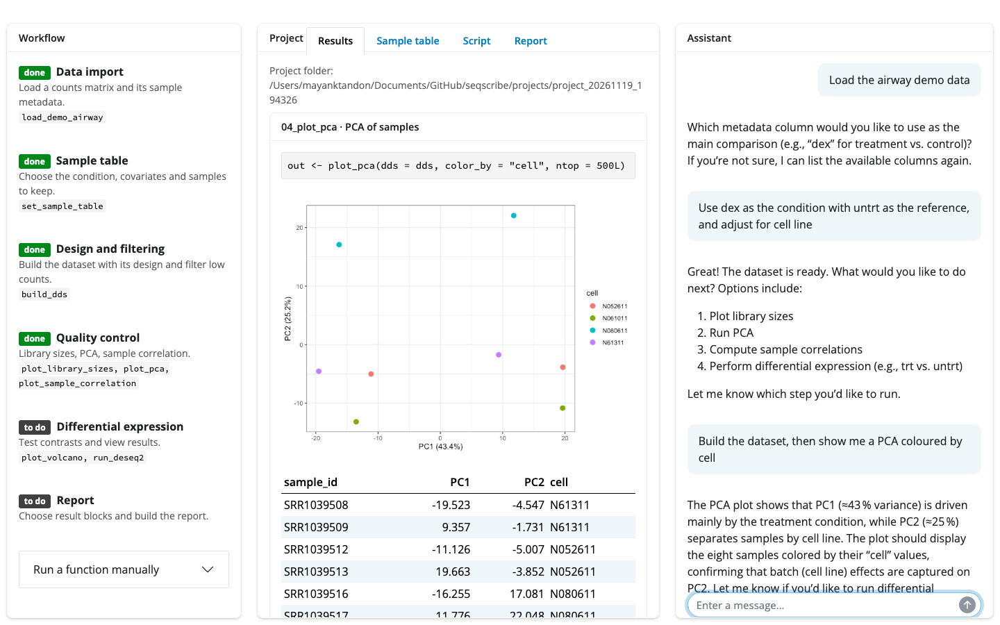
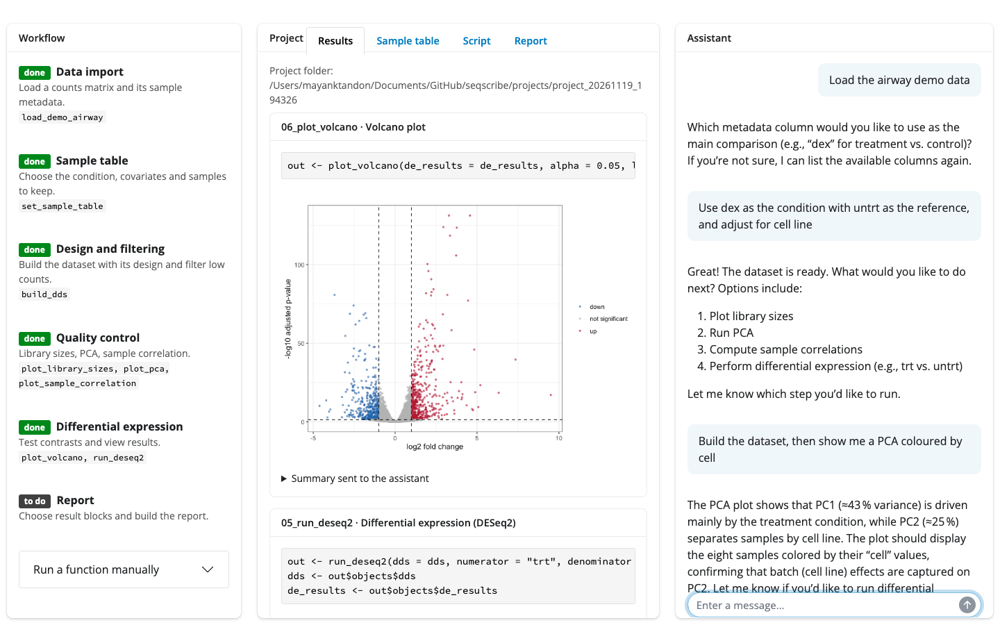
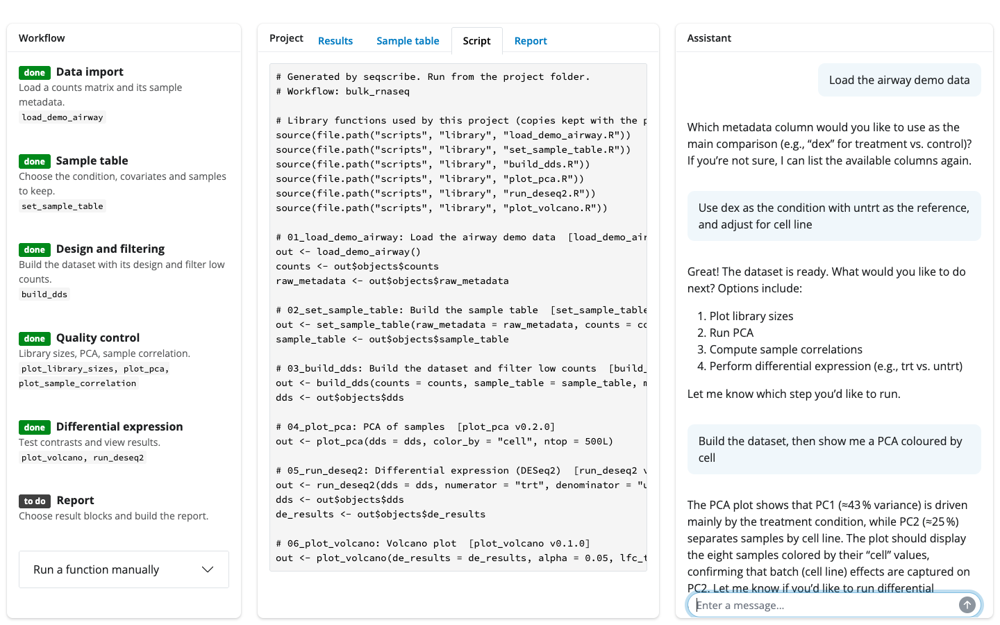
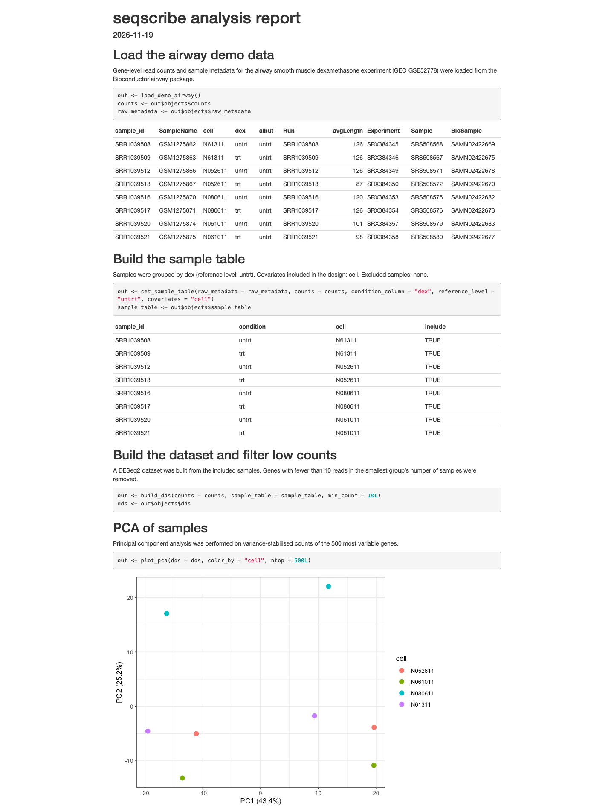

# seqscribe

A plain-language analysis workbench for sequencing data, powered by a locally
hosted LLM. You direct the analysis in the chat; seqscribe turns each request
into calls to a curated, editable library of analysis functions, keeps a running script you
can read and edit, and stitches the results you choose into an R Markdown
report.

**Status:** first prototype. It runs end to end from the manual form; the chat
has not been tested against a local model yet. It covers
one thin slice of bulk RNA-seq on the airway demo dataset: load data, build
the sample table, QC, one DESeq2 contrast, and a report.

## What it looks like

Captured on 2026-11-19 with `openai/gpt-oss-20b` in LM Studio, running the
five demo requests from the chat greeting.

The assistant turns each request into library calls; the results appear in
the centre, and the workflow map on the left marks steps as done.



Differential expression and a volcano plot, also run from the chat. Each
result card shows the code that ran and, folded, the summary the assistant
was sent.



The Script tab holds a standalone script for everything run so far, calling
the project's own copies of the library functions.



The report stitches the chosen steps into an R Markdown document, with
methods text from each library entry (top of the report shown).



## Running the prototype

1. Install the R packages (once):

   ```r
   install.packages(c(
     "shiny", "bslib", "shinychat", "ellmer", "config", "yaml", "jsonlite",
     "httr2", "knitr", "promises", "rlang", "ggplot2", "rmarkdown", "pkgload",
     "BiocManager"
   ))
   BiocManager::install(c("DESeq2", "airway", "SummarizedExperiment"))
   ```

   Rendering the report also needs pandoc. RStudio bundles a copy; when
   launching from a terminal, install pandoc or point `RSTUDIO_PANDOC` at
   RStudio's copy.

2. In LM Studio, load a model that supports tool use, set its context length
   to about 16k, and start the local server (default address
   `http://localhost:1234/v1`).
3. Check that `llm.model` in `inst/config/config.yml` matches the model name
   LM Studio shows. Personal overrides can go in a `config.local.yml` in the
   repo root.
4. Launch from the repo root:

   ```r
   shiny::runApp()
   ```

The app has three panels: the workflow map and a manual "run a function" form
on the left, the project (results, sample table, script, report) in the
centre, and the assistant on the right. Each session creates a new folder
under `projects/` holding the spec, the generated script, results and report.

If the assistant is not connected, a banner says why, and the manual form
still works. That is also the quickest way to tell an R problem from an LLM
problem.

To run the tests: `pkgload::load_all(); testthat::test_dir("tests/testthat")`.

## Where things are

| Path | What it holds |
|---|---|
| `CLAUDE.md` | Vision, design principles and current state. Start here. |
| `docs/architecture.md` | The design in more depth |
| `docs/decisions.md` | Dated log of choices and the reasons |
| `docs/hpc-questions.md` | Open questions for HPC staff |
| `inst/config/` | App settings and profiles |
| `inst/library/` | The function library: one self-contained folder per function |
| `inst/workflows/` | Ordered steps for each analysis type |
| `inst/prompts/` | LLM prompts |
| `inst/templates/` | Report skeleton (per-function fragments live with each library entry) |

## License

MIT. See `LICENSE.md`.
